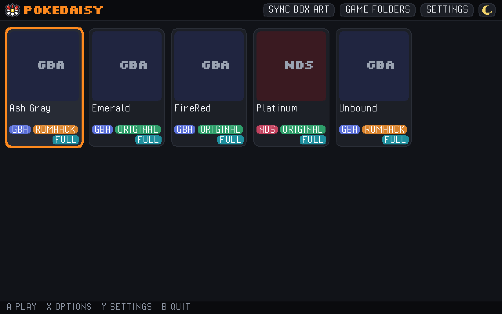
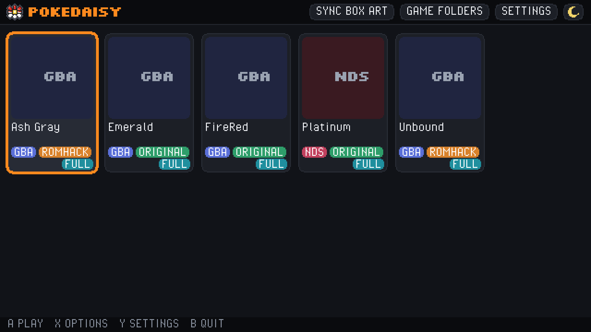

# PokeDaisy for Windows and Linux

> [!IMPORTANT]
> **This is a fork of [PokeDaisy](https://github.com/lidor30/pokedaisy), made by Lidor Itzhari ([lidor30](https://github.com/lidor30)).**
> PokeDaisy, its companion and its design are Lidor's work. This fork only adds the Windows and Linux desktop /
> handheld version. For the Android app use [the original project](https://github.com/lidor30/pokedaisy), and if you
> enjoy PokeDaisy, support Lidor on [Patreon](https://www.patreon.com/cw/pokedaisy),
> [Buy me a coffee](https://buymeacoffee.com/lidor30g) or [Ko-fi](https://ko-fi.com/pokedaisy). PokeDaisy stays under
> the GNU GPL v3 with Lidor's copyright and credit notices kept as they are ([LICENSE](LICENSE), [NOTICE](NOTICE)).

One portable program for Windows handhelds (ROG Ally, Legion Go, OneXPlayer, ...), PCs and Linux that plays the Game
Boy, Game Boy Color, GBA and Nintendo DS Pokemon games you own, with PokeDaisy's live companion beside the game on one
screen: your party, bag, map, battle matchups, Pokedex and a spoiler-free guide.

<p>
  
  
  
  
</p>

<p>
  
  
</p>

The same build on two handhelds: a OneXPlayer 3 (left, 1920 x 1200, 16:10) and a ROG Xbox Ally (right, 1920 x 1080,
16:9). Everything fits itself to the screen's shape.

## Install and update

1. Download `PokeDaisy-<version>-windows-x86_64.zip` (or `PokeDaisy-<version>-linux-x86_64.zip`) from the top `desktop-v` release on the
   [Releases](https://github.com/kinetic-hq/pokedaisy/releases) page. `SHA256SUMS.txt` has the checksums. (The
   release's `pokedaisy-windows-x86_64.zip` is the same zip under the name older versions update from.)
2. Unzip it somewhere you can write to (Documents, not `Program Files`). Keep `PokeDaisy.exe` and `SDL2.dll` together.
3. Put your `.gb`, `.gbc`, `.gba` and `.nds` files in `DATA\roms` (or add your own folders with `GAME FOLDERS`) and
   open `PokeDaisy.exe`. The first start walks you through a few choices.

Updates come by themselves: each start looks for a newer release and offers `UPDATE NOW`, `LATER` or `SKIP THIS
VERSION`, and an update only replaces the program, never your `DATA` folder (settings, saves, states). Desktop builds
are a beta, so every release is marked pre-release. Turn the check off with `SETTINGS` > `CHECK FOR UPDATES`.

The full guide is in [docs/manual/windows.md](docs/manual/windows.md) (and [linux.md](docs/manual/linux.md)), and
[android-parity.md](docs/manual/android-parity.md) compares it with the Android app. When
something goes wrong, `DATA\pokedaisy.log` is what to attach to a report.

## Game support

The goal is for every supported game to be `FULL`. The games the maintainer plays come first, then every other game
listed on the site. Each tile in the game list carries a tag:

- `FULL`: every companion tab follows the game (PARTY, BAG, DEX, MAP, GUIDE and, in a battle, BATTLE).
- `PARTLY`: the game runs and the companion follows it, but a tab is missing or it's read as the game it's built on.
  `COMPANION` in the game's options says what's missing.
- `PLAY ONLY`: the game runs, but the companion doesn't follow it yet.

`PARTLY` and `PLAY ONLY` are steps on the way to `FULL`, not where a game stops.
[desktop-game-support.md](docs/manual/desktop-game-support.md) lists each game's state and what's left.

### Game compatibility

Every game the companion knows, on Android and on Windows / Linux. The Android column comes from
[PokeDaisy's own table](https://github.com/lidor30/pokedaisy#supported-games), where a game is ✅ when it has every
tab there and ◐ when one is missing. The Windows / Linux column is the tag the game list shows, with what's missing
when it's `PARTLY`. "Real save" means the game was checked on the desktop against a save from a real playthrough, "Run
on copy" that it was run on a copy of the game, and "Not yet" that it hasn't been run on the desktop yet. Any other
Game Boy, Game Boy Color, GBA or DS game still plays, as `PLAY ONLY`.

✅ works · ◐ partly · ❌ play only

| Game | Version | Platform | Original or ROM hack | Android | Windows / Linux | Tested on desktop |
| --- | --- | :-: | --- | :-: | --- | --- |
| Red / Blue (GB) | USA/Europe | GB | Original | ✅ | ✅ FULL | Not yet |
| PureRed / PureBlue (GB) | 2.7.6 | GB | ROM hack | ◐ | ◐ PARTLY: no GUIDE | Not yet |
| Yellow (GB) | USA/Europe | GB | Original | ✅ | ✅ FULL | Not yet |
| Yellow (GB) | DE / FR / IT / ES | GB | Original | ✅ | ✅ FULL | Not yet |
| Yellow Legacy (GB) | 1.0.10 | GB | ROM hack | ✅ | ✅ FULL | Not yet |
| Gold / Silver (GBC) | USA/Europe | GBC | Original | ◐ | ◐ PARTLY: no GUIDE | Not yet |
| Crystal (GBC) | USA, USA/Europe rev 1, AU | GBC | Original | ✅ | ✅ FULL | Not yet |
| Crystal Legacy (GBC) | 1.3.1 | GBC | ROM hack | ✅ | ✅ FULL | Not yet |
| Crystal Clear (GBC) | 2.5.11, 2.6.0 (4 builds) | GBC | ROM hack | ◐ | ◐ PARTLY: no GUIDE | Not yet |
| Prism (GBC) | 0.95 build 254 | GBC | ROM hack | ◐ | ◐ PARTLY: no GUIDE | Not yet |
| Polished Crystal (GBC) | 3.2.0-3.2.3 (16 builds) | GBC | ROM hack | ✅ | ✅ FULL | Not yet |
| FireRed | USA/Europe, rev 0 and 1 | GBA | Original | ✅ | ✅ FULL | Real save |
| FireRed | ES / DE / FR / IT / JP | GBA | Original | ✅ | ◐ PARTLY: no GUIDE on the Japanese cart; no foe team in the DE / FR / IT / JP carts | Not yet |
| LeafGreen | USA/Europe, rev 0 and 1 | GBA | Original | ✅ | ✅ FULL | Not yet |
| LeafGreen | ES / DE / FR / IT / JP | GBA | Original | ✅ | ◐ PARTLY: no GUIDE on the Japanese cart; no foe team in the DE / FR / IT / JP carts | Not yet |
| Emerald | USA/Europe | GBA | Original | ✅ | ✅ FULL | Real save |
| Emerald | ES / DE / FR / IT / JP | GBA | Original | ✅ | ◐ PARTLY: no GUIDE on the Japanese cart | Not yet |
| FireRed / Emerald, randomized | UPR ZX 4.6.1, USA/Europe | GBA | Randomized | ✅ | ✅ FULL | Not yet |
| Ruby | USA, rev 0, 1 and 2 | GBA | Original | ✅ | ✅ FULL | Not yet |
| Ruby | ES/DE/FR/IT/JP, rev 0-1 | GBA | Original | ✅ | ◐ PARTLY: no GUIDE on the Japanese cart | Not yet |
| Sapphire | USA, rev 0, 1 and 2 | GBA | Original | ✅ | ✅ FULL | Not yet |
| Sapphire | ES/DE/FR/IT/JP, rev 0-1 | GBA | Original | ✅ | ◐ PARTLY: no GUIDE on the Japanese cart | Not yet |
| Platinum (DS) | USA rev 1, FR/ES rev 0 | NDS | Original | ✅ | ✅ FULL (USA cart) | Real save |
| HeartGold (DS) | USA, EU, every language | NDS | Original | ◐ | ✅ FULL (USA cart) | Not yet |
| SoulSilver (DS) | USA, EU, every language | NDS | Original | ◐ | ✅ FULL (USA cart) | Real save |
| Black (DS) | USA/Europe, every language | NDS | Original | ✅ | ✅ FULL (USA / Europe cart) | Real save |
| White (DS) | USA/Europe, every language | NDS | Original | ✅ | ✅ FULL (USA / Europe cart) | Not yet |
| Black 2 (DS) | USA/Europe, every language | NDS | Original | ✅ | ✅ FULL (USA / Europe cart) | Not yet |
| White 2 (DS) | USA/Europe, every language | NDS | Original | ✅ | ✅ FULL (USA / Europe cart) | Real save |
| Origin HeartGold (DS) | 4.0.3 English 1.0.0 | NDS | ROM hack | ◐ | ◐ PARTLY: GUIDE has HERE and NEXT BOSS | Run on copy |
| Renegade Platinum (DS) | 1.2.0, 1.3.0 (+ Classic) | NDS | ROM hack | ◐ | ◐ PARTLY: GUIDE has HERE and NEXT BOSS | Run on copy |
| Unbound | 2.1.1.1 | GBA | ROM hack | ✅ | ✅ FULL | Run on copy |
| Unbound | 2.1.1.1 French | GBA | ROM hack | ✅ | ✅ FULL | Not yet |
| Radical Red | 4.1 | GBA | ROM hack | ✅ | ✅ FULL | Not yet |
| Gaia | 3.2 | GBA | ROM hack | ✅ | ✅ FULL | Real save |
| Odyssey | 4.1.1 | GBA | ROM hack | ✅ | ✅ FULL | Real save |
| Heart and Soul | 2.0.6 | GBA | ROM hack | ✅ | ✅ FULL | Run on copy |
| Amethyst | 1.3.0, 1.4.1, 1.4.3 | GBA | ROM hack | ✅ | ✅ FULL | Run on copy |
| Celia's Stupid Romhack | 1.1.4 | GBA | ROM hack | ✅ | ✅ FULL | Not yet |
| Orange Islands | Beta 5.7, an older beta | GBA | ROM hack | ✅ | ✅ FULL | Run on copy |
| Ultra Violet | 1.22 | GBA | ROM hack | ✅ | ✅ FULL | Not yet |
| FireRed Rocket Edition | the one release | GBA | ROM hack | ✅ | ✅ FULL | Run on copy |
| Ash Gray | 4.5.3, Fork Bug Fix 1.0 | GBA | ROM hack | ✅ | ✅ FULL | Real save |
| Ghost Grey | 1.0.1, 1.0.2, 1.0.4 | GBA | ROM hack | ✅ | ✅ FULL | Not yet |
| Let's Go | English (4 builds) | GBA | ROM hack | ✅ | ✅ FULL | Run on copy (Pikachu) |
| Sword and Shield Ultimate Plus | 1.2.1.2 + its 3 patches | GBA | ROM hack | ✅ | ✅ FULL | Not yet |
| GS Chronicles | 2.7.6 | GBA | ROM hack | ✅ | ✅ FULL | Not yet |
| Recharged Yellow | 1.8.0, 1.9.0, 1.9.4, 1.9.7 | GBA | ROM hack | ✅ | ✅ FULL | Not yet |
| Emerald Legacy | 1.1.4 | GBA | ROM hack | ✅ | ✅ FULL | Not yet |
| Lazarus | 2.0 | GBA | ROM hack | ✅ | ✅ FULL | Run on copy |
| Emerald Seaglass | 3.0 | GBA | ROM hack | ✅ | ✅ FULL | Run on copy |
| Too Many Types 2 | 1.5.2 | GBA | ROM hack | ✅ | ✅ FULL | Run on copy |
| Glazed | 9.2.0 | GBA | ROM hack | ✅ | ✅ FULL | Real save |
| Emerald Imperium | 1.3.1 | GBA | ROM hack | ✅ | ✅ FULL | Run on copy |
| Quetzal | English Alpha 9 v0 | GBA | ROM hack | ✅ | ✅ FULL | Not yet |
| Quetzal | Spanish Alpha 9 v0 | GBA | ROM hack | ✅ | ✅ FULL | Not yet |
| Quetzal | Alpha 9 v1 (EN / ES) | GBA | ROM hack | ✅ | ✅ FULL | Not yet |
| Quetzal | Alpha 0.8.4 (EN / ES) | GBA | ROM hack | ✅ | ✅ FULL | Not yet |
| Moemon Quetzal | Alpha 0.8.4 Hotfix (EN/ES) | GBA | ROM hack | ✅ | ✅ FULL | Not yet |
| Super Mariomon | 1.2.1-1.3, 1.5.1, 1.5.2 | GBA | ROM hack | ✅ | ✅ FULL | Not yet |
| Recharged Emerald | 2.2.5, 2.2.8, Rebalanced | GBA | ROM hack | ✅ | ✅ FULL | Not yet |
| Modern Emerald | 3.6 | GBA | ROM hack | ◐ | ◐ PARTLY: no GUIDE (none on Android either) | Run on copy |
| Elite Redux | 2.65.3b, 2.65.4.1b | GBA | ROM hack | ✅ | ✅ FULL | Not yet |
| Team Rocket Dragonsden | 1.5 | GBA | ROM hack | ◐ | ◐ PARTLY: no DEX | Not yet |
| Team Rocket Dragonsden | 2026 3.0.9 (Spanish) | GBA | ROM hack | ✅ | ✅ FULL | Not yet |
| Wishes of Tomorrow | 1.2.6 | GBA | ROM hack | ✅ | ✅ FULL | Real save |
| Petalburg Dynasty | 1.12.2 | GBA | ROM hack | ✅ (not in its table) | ✅ FULL | Run on copy |
| Dreamstone Mysteries | the one release | GBA | ROM hack | ✅ | ✅ FULL | Run on copy |
| Monomyth | 1.0, 1.1 | GBA | ROM hack | ✅ | ✅ FULL | Run on copy |
| Emerald Rogue | 2.2.1-EX | GBA | ROM hack | ◐ | ◐ PARTLY: no GUIDE (none on Android either) | Run on copy |
| SoulGold | 1.1.4, 1.2 (3), 1.2.1 (2) | GBA | ROM hack | ✅ | ✅ FULL | Run on copy (1.2.1) |
| R.O.W.E. | 2.1.9.1 Experimental | GBA | ROM hack | ◐ | ✅ FULL | Run on copy |

On the DS, the desktop's companion reads the USA carts of Platinum, HeartGold and SoulSilver and the USA / Europe
carts of Black, White, Black 2 and White 2; the other languages play without it for now.
[desktop-game-support.md](docs/manual/desktop-game-support.md) goes through each tab, game by game.

## OLED handhelds (OneXPlayer 3, Legion Go 2)

An OLED screen doesn't light black pixels at all, so PokeDaisy can keep everything around the game dark:

- `SETTINGS` > `SCREEN` > `DISPLAY OPTIONS` > `COLORS` > `OLED`: a little less glare, and the panels round the game go
  true black. With `OLED` (and in every DS game) `BACKGROUND` starts on `BLACK`.
- The companion's wings become near black cards with a faint edge; `DIM COMPANION` darkens them further.
- Against burn in, wings that haven't changed for a minute dim, and they move by a pixel every few minutes.
- `BRIGHTNESS` (80% to 150%) brightens the game itself if the darker look is too dim in daylight.

## How this fork differs from PokeDaisy

| Area | What the fork adds |
| --- | --- |
| Platforms | A Windows build of the desktop host (one zip for GBA, Game Boy and DS), Linux zips, self-updates and automatic `desktop-vX.Y.Z` pre-releases |
| Nintendo DS | melonDS, `DS LAYOUT` (one screen, picture in picture, stacked, side by side, large + small, wings, touch pieces), `TOUCH WINDOW` (the touch screen in a window of its own, for a second monitor), touch by mouse, finger or controller, rewind, time of day and Berry Pots |
| Companion on one screen | `COMPANION VIEW`: `BATTLE WINGS`, `WINDOW`, `SIDE PANEL`, `WINGS`, `GLASS DRAWER`, `STEP BACK`, with redesigned wing cards |
| Screen | `SHARP` / `xBRZ`, `HANDHELD` / `OLED` colours, `BRIGHTNESS`, black backgrounds and bezel bars, full screen, `ORIENTATION` |
| Controls | Hot plugged controllers (several at once), `NINTENDO` / `XBOX` layouts, hotkeys for paddles and extra buttons, touch and mouse, rumble |
| Games and saves | A box art game grid, your own game folders with saves beside the games, ten state slots, resume, per-game settings, `EDIT SAVE` |
| Play | Level cap, low PP warning, battery saver |
| Games | A [game compatibility](#game-compatibility) table comparing Android with Windows / Linux |

Every change, one line each (a pull request that changes what the fork adds updates this list):

<details>
<summary>The full list</summary>

- **Windows build of the desktop host**: one portable zip that plays GBA, Game Boy and DS games, with an icon,
  a UTF-8 manifest and safe save / state writes on Windows.
- **Nintendo DS on melonDS** in the desktop host, with `DS LAYOUT` (six ways to place the two screens) and touch by
  mouse, finger or controller. `TOUCH WINDOW` (an experiment) puts the touch screen in a second window, for a
  second monitor or a two-screen handheld. In `TOUCH IN WING` a tap on the wing's touch screen pops it out large
  over the game; a tap outside or B puts it back. `TOUCH IN WING` and `WINGS` keep their wings on 2560 x 1600
  screens, roomy enough for the party's names, and EXPAND's picture stays between the wings.
- **COMPANION VIEW** on the desktop host: `BATTLE WINGS`, `WINDOW`, `SIDE PANEL`, `WINGS`, `GLASS DRAWER` and
  `STEP BACK`.
- **Controllers**: hot plugging, several at once (a handheld's own controls and an Xbox pad together).
- **Shaders and colours** on the desktop host: `SHARP` and `xBRZ` scaling, `HANDHELD` and `OLED` colours,
  `BRIGHTNESS` (80% to 150%, 110% by default), `DIM COMPANION`, and `BACKGROUND` (`BLACK` by default with
  `OLED` and in every DS game, `DARK` with `DARK MODE`): true black round the game, the wings as near black cards with a faint edge (dark mode and themes
  reach them too), a thin grey gutter at the game's border, still wings dimmed after a minute and moved a pixel
  every few minutes against burn in. The wings fill the screen's height: the party as tall cards, the map round
  the player with badges, play time and money under it. Bezel bars above and below the game where there's room
  (`BEZEL STYLE` `BLACK` / `GLOW` / `THEME`, what they show picked in `LAYOUT`, the foe and matchups in a battle).
- **More in the bezel bars** on the desktop host: `NEXT BOSS AND CAP`, `CAUGHT HERE`, `LEAD POKEMON` (HP and EXP to
  go) and `LAST SAVED` (a warning after 30 minutes), the bottom bar starting on lead / next boss / money; an empty
  place borrows something neither bar shows, larger text, and the bars now show on 16:9 screens with the wings.
- **Redesigned wing cards** on the desktop host: rounded cards with a soft gradient and a type colour stripe,
  shiny star and held item marks, pixel headings (Silkscreen) and clear numbers (Atkinson Hyperlegible), HP
  bars that glide and cards that slide in when the party changes (`REDUCE MOTION` turns both off).
- **Wings that move**: a gold glow on a card that levels up, a popping new badge, money that counts to its new sum, bars that fade between words, and short notes over the right wing for a level up, a new area, a save or the spray wearing off (`REDUCE MOTION` stops the motion)
- **Battle wing**: the matchup wing lists the types the foe is weak to and, at its foot, the party Pokemon to switch to
- **UI SIZE, WING ROOM and STRETCH** on the desktop host: the menus, HUD, wings and companion are drawn a size
  smaller by default (`UI SIZE` `MEDIUM`; `LARGE` is the old size, `SMALL` smaller still), `WING ROOM` shares the
  width between the game and the wings (`AUTO` by default: `WINGS FIRST` while the game still fills 80% of the height, else
  `BALANCED`; or `GAME FIRST`, `BALANCED`, `WINGS FIRST`), `STRETCH` (off) lets
  the game lose up to 5% of its shape to fill the screen, and the zoom buttons turn `EXPAND` on themselves. The DS
  layouts with wings and the DS companion follow `WING ROOM` and `UI SIZE` too
- **Tap the HUD and zoom in WINGS** on the desktop host: the HUD's party slots, minimap, balls, `PC`, `BAG`, `WILD`
  and `COMPANION` answer a tap or click, the first click on the window counts, a tap on the party wing in a battle
  opens `PARTY`, and LT / RT zoom the game's area in `WINGS`
- **Wing look and clicks** on the desktop host: `WING LOOK` (`COMPACT`, `COMFY`, `BIG`) sizes the wings, `BACKGROUND` `BLUR` puts a blurred copy of the game behind the cards, a click on a wing opens the companion on its page, the map wing shows this area's wild kinds as icons (the ones not caught yet faded), and a small card at the bottom of the left wing shows the buttons when no bar does
- **Fuller wings** on the desktop host: an EXP bar under each HP bar, an outlined card with a ball for each free
  party place (seen on dark wings too), long names given the level's room before they're cut, badges as eight
  dots, the next boss and this area's catches under the map, nothing the bars already show said again, and bar
  text a size larger (a step smaller when three places wouldn't fit).
- **Game folders and saves beside games** on the desktop host: folders picked in the app (`GAME FOLDERS`,
  a folder browser that works with a controller) are listed with one level inside them, and their GBA / Game
  Boy saves sit next to the game (`SAVES BESIDE GAMES`, on), so an existing emulation folder works as it is.
- **Full screen** on the desktop host: `FULLSCREEN` (borderless) switched any time by F11, Alt+Enter, L3 + R3, the
  game menu or `SETTINGS`, remembered, and on by default the first time on a handheld's screen.
- **Button layout and hotkeys** on the desktop host: `BUTTON LAYOUT` `XBOX` (the default on a first start; an existing setup keeps its own) / `NINTENDO` picks which face button is
  A; LT / RT zoom out / in and L3 toggles fast forward by default (L2 / R2 stay the DS controls in a DS game);
  a tap on R3 switches WINGS / BATTLE WINGS (in a DS game it steps the DS layouts, skipping any that look the same
  on your screen), a hold picks a view; the triggers, sticks and extra
  buttons (GUIDE, SHARE, back paddles) can each be given a job in `HOTKEYS`: game menu, companion, fast forward,
  states, screenshot, full screen, DS layout, swap screens, zoom in / out. EXPAND's camera eases in for text,
  menus and battles and back out after, like the Android app's.
- **Touch and orientation** on the desktop host: touch and the mouse on the game list, menus and companion,
  `GAME TOUCH` (`DS SCREEN ONLY` / `OFF`) for the game itself, and `ORIENTATION` turning the whole picture and touch
  for a screen mounted upright or upside down.
- **Android's settings menus** on the desktop host: the companion's `SETTINGS` in the app's groups and order, and
  a picker for `COMPANION VIEW` and `DS LAYOUT` that draws every choice, from the companion or the game list.
- **Game grid with box art** on the desktop host: the game list is a grid of box art (libretro thumbnails, then
  SteamGridDB with your own key; your own picture wins), each game with its system, `ORIGINAL` / `ROM HACK` and its
  version; `GAME FOLDERS` and `SETTINGS` in a slim top bar; `CHOOSE BOX ART` (a picker over every cover found, see below) and
  `RENAME` from `X`, a right click or a long press; D-pad, mouse, wheel and touch.
  Tiles are box shaped (3:4) with the art filling them, long names wrap to up to three lines, `SYNC BOX ART` fetches
  every game's art with progress (`MISSING ONLY` or `ALL AGAIN`), an original under any file name gets its box from
  its header's game code, and a hack with no art of its own gets its base game's box with a name banner.
- **DS wings** on the desktop host: `TOUCH IN WING` puts the touch screen in one wing and the companion's party in
  the other; `WINGS` is `ONE SCREEN` with party and trainer panels in both wings and the touch screen floating in;
  `TOUCH PIECES` takes the touch screen apart into its buttons, each on a card in the wings, balanced between them
  (HeartGold / SoulSilver's and Platinum's battle menu, moves, bag and party; other screens and games get the screen's
  two halves).
- **Low PP warning** on the desktop host: a move's PP turns orange at a quarter left (2 where the full PP isn't known)
  and red at 0, in the summary, the party's move list and the battle's moves.
- **Level cap** on the desktop host: SETTINGS > GAMEPLAY > LEVEL CAP takes the next unbeaten leader's top level as the
  cap, named under GUIDE > NEXT BOSS, and party levels past it show orange.
- **Save state slots** on the desktop host (GBA and Game Boy): ten per game in the companion's STATES tab, each with a
  picture and the time it was saved; the save / load hotkeys follow the picked slot, and slot 0 is the old single state.
- **Resume games** on the desktop host (GBA and Game Boy, like DS's AUTO-RESUME): leaving a game keeps a state, and
  the next start asks CONTINUE or START FROM SAVE (SETTINGS > APP > RESUME GAMES, on); the save file is never touched.
- **Rewind on the desktop host, DS too**: a `REWIND HOLD` hotkey (any HOTKEYS button, or R on a keyboard) rewinds
  while held; DS games keep a state a second for the last 20 s, never taking back the battery save.
- **Rumble** on the desktop host (SETTINGS > CONTROLS > RUMBLE, off): the controller buzzes as a battle starts,
  harder for a shiny foe, and with a rumble cartridge.
- **Per-game settings** on the desktop host (SETTINGS > APP > THIS GAME ONLY): a game keeps its own settings in
  `DATA/game-settings/`, while buttons, hotkeys, the window and the like stay program-wide.
- **Battery saver** on the desktop host (SETTINGS > APP > BATTERY SAVER, AUTO = on battery): fast forward capped at
  3x, xBRZ drawn as SHARP, the companion and game list redrawn half as often.
- **DS time of day and Berry Pots** on the desktop host: the DS facts wing shows MORNING / DAY / (EVENING) / NIGHT,
  and HeartGold / SoulSilver get their party and facts wings with each Berry Pot's berry, stage, time left and DRY.
- **DS buttons as a GBA game's** on the desktop host: `HOTKEYS` now apply in DS games too, so by default LT / RT
  zoom (the game against the wings), L3 fast forwards (new on DS: three frames a turn, muted), R3 steps / picks the
  DS layout, `GUIDE / HOME` opens the quick menu and SELECT + R3 swaps the screens; `USUAL USE` on LT / RT gives
  back the DS's own L2 quick menu and R2 swap.
- **DS companion in the app's look** on the desktop host: the DS companion, pause screen and toasts use the theme's
  backdrop, windows and tab colours (and `DARK MODE`) like the GBA companion, and fill the window at `UI SIZE`'s
  scale instead of a small fixed box.
- **The full DS companion** on the desktop host: DS games get the handheld core's companion (`PARTY` summaries, `BAG`
  pockets, `DEX` pages, `MAP` with `PLACES`, `GUIDE`, and `BATTLE` with the foe and your moves' verdicts) instead of
  a text list, with the desktop's DS rows under its `SETTINGS`; HeartGold and SoulSilver (USA) get it all too, on
  the app's HeartGold field read (`BATTLE`, auto battles, the HUD and wings with the party's icons).
- **FireRed rev 0's tables**: the USA/Europe 1.0 cart gets the `DEX` pages, the `GUIDE`'s trainers and wild
  Pokemon, and the foe's team in `BATTLE`, on the desktop, the 3DS port and Android alike.
- **LeafGreen rev 0's foe team**: the USA 1.0 cart shows the trainer's whole team in `BATTLE` (FireRed rev 0's
  battle RAM, which it shares), on every platform.
- **Foe teams in six hacks**: Gaia, Odyssey, Unbound, Heart and Soul, Radical Red and Celia's hack show the trainer's whole team in `BATTLE`,
  on the desktop, the 3DS port and Android alike.
- **ASPECT starts on EXPAND** on the desktop host (Android starts on `ORIGINAL`), so `AUTO ZOOM IN` and the zoom hotkeys work
  from the first game; `ORIGINAL` stays a choice, and a pick you made is kept.
- **The game grid** on the desktop host: whole covers (never cropped), a `FULL` / `PARTLY` / `PLAY ONLY` tag from
  the companion's own detection (`COMPANION` in a game's options says what's missing), `ROMHACK` on every hack's tile,
  SteamGridDB art only for the same name and in English (its escaped "Pok\u00e9mon" read as the word it is, spaces and
  "and" not counting, and a hack left on its base game's box looked for again once), and dialogs drawn over the dimmed art.
- **CHOOSE BOX ART picker** on the desktop host: a game's `CHOOSE BOX ART` option shows every cover as a grid, like
  SteamGridDB's own picker in Steam's Big Picture: the pictures in its box art folder first (its box art, then the
  alternates), libretro's cover and the base game's box, then every SteamGridDB grid for the game, a page at a time as
  you scroll, each tagged with its source and size. `SHAPE` shows box shaped covers or all of them, `SEARCH AGAIN`
  types another name and picks SteamGridDB's game from a list, `FROM URL` takes a copied or typed link and `FROM FILE`
  browses for a PNG or JPG. A pick is the game's own art: `SYNC BOX ART` never replaces it.
- **Box art folders** on the desktop host: a game's chosen art is a plain picture named after the game
  (`Pokemon Emerald.png`, any case, with or without the é or the "Pokemon "), in a `boxart` folder beside the ROMs
  (`BOX ART LOCATION` > `BESIDE GAMES`, made only when the first picture is saved) or in one folder of your own with a
  folder per console (`ONE FOLDER`). `Name 1.png`, `Name 2.png` and so on are alternates, yours or kept by the program:
  a new pick turns the old one into the next free alternate, nothing is ever overwritten, and picking an alternate
  swaps the names. Art picked in an older version is copied over once and left where it was.
- **Black, White, Black 2 and White 2 on the desktop host**: the USA / Europe carts (any dump with their header) get the
  whole DS companion (`PARTY`, `BAG`, `DEX`, their own Town Map in `MAP`, `GUIDE`, `BATTLE`), the party and facts wings,
  the HUD and EXPAND, on the app's Gen 5 reader and field reads.
- **Origin HeartGold's type chart on Android** is found inside the game's own code, so other dumps of the same build
  read the right matchups instead of stray bytes.
- **Renegade Platinum on the desktop host**: its own names, species types, moves, Fairy type, type chart, TMs and icon
  palettes come from the cart, so `PARTY`, `BATTLE` and `DEX` show the hack's data; its `GUIDE` tab is hidden (as on
  Android), and so is Origin HeartGold's.
- **Origin HeartGold's `GUIDE` on the desktop host** (beyond Android, which has none for it): `HERE` lists the wild
  creatures where you stand by time of day, read from the cart's own map headers and encounter tables, and the `DEX`
  page's where-to-find uses them too. `NEXT BOSS` shows the next gym leader or League member with the hack's own team,
  read from the cart's trainer data, in the order of their levels (Kanto's leaders first).
  `HERE` also lists the item balls and hidden items where you stand, from the cart's map events and scripts.
- **Renegade Platinum's `GUIDE` on the desktop host** (beyond Android, which has none for it): `HERE` lists the wild
  creatures where you stand by time of day, from the cart's own map headers and encounter tables, and `NEXT BOSS` shows
  the next gym leader or League member with the hack's own team, read from the cart's trainer data.
  `HERE` also lists the item balls and hidden items where you stand, from the cart's map events and scripts.
- **Origin HeartGold's `BATTLE` on the desktop host**: its own battle engine's objects are read (as on Android): your
  creature and the foe with their stats, types and moves, and a trainer's team.
- **Origin HeartGold on the desktop host**: `PARTY`, `BAG`, `MAP` and `DEX` (Pokédex pages, pictures, learnsets,
  machines, evolutions) on its own save offsets, with its species, moves, items, Fairy type and type chart read from
  the cart. No `BATTLE` panes yet.
- **DS EXPAND** on the desktop host: Platinum, HeartGold and SoulSilver (and the games built on them) draw their world past
  the top screen's edges, Android's EXPAND (`pk_nds_wide.cpp`) on the desktop's melonDS, with the GBA's zoom steps and
  AUTO ZOOM IN.
- **The game list's header** on the desktop host: the app's daisy, redrawn as 16 x 16 pixel art, beside the PokeDaisy
  name, instead of "PokeDaisy Windows" / "PokeDaisy Linux" (the window title and SETTINGS' HOST row keep the platform).
- **DEX for expansion hacks** on the desktop host and the 3DS port: Heart and Soul, Wishes of Tomorrow, Dreamstone
  Mysteries and Lazarus (and any pokeemerald-expansion game whose gSpeciesInfo the ROM is seen to hold) get the `DEX` tab, read
  from the game's own species data (Lazarus, which zeroes the species it leaves out, is checked on another one); the game grid's support tag asks the same rule.
- **Monomyth's DEX** on the desktop host, from its own tables (its pages, smol pictures and region list), and **metric
  units** on the `DEX` page of every GBA game whose cart uses them (Monomyth, the European and Japanese carts), as in the app.
- **EGG GROUP on the DEX page** on the desktop host for the GBA games, read from each game's own base stats (Monomyth's
  packed into one byte), as the app shows them.
- **Amethyst 1.4.3's DEX** opens on the desktop host: the check that its tables are where we think now reads the first
  Pokemon's entry under the game's own number (No. 301 there) instead of assuming No. 1.
- **Modern Emerald's DEX tab** on the desktop host, which the app doesn't have: its 215 Hoenn and 432 National, with SEEN / OWN
  from its own save layout, and `EVOLVE`, `AREA` and `MOVES` on each entry (`MOVES` follows the save's POKéMON MOVEPOOL
  setting, as the game does).
- **Emerald Seaglass's DEX tab** on the desktop host, in the game's own numbering (Hoenn first), read from its species data,
  with `EVOLVE`, `AREA` and `MOVES` on each entry (`MOVES` lists what the Pokemon can be taught instead of TMs and HMs).
- **HIDDEN ability, GENDER ratio, CATCH RATE and stat TOTAL on the DEX page** on the desktop host for the GBA
  games, on a window big enough for them (the 3DS page keeps its old lines), as the app shows them.
- **Monomyth's DEX sections and GUIDE** on the desktop host: `EVOLVE` (its own eight-row evolution table and methods),
  `AREA` and `MOVES`, and the guide's trainer teams and wild tables (its trainer parties sit behind a header of its own).
- **Amethyst 1.4.3**: its own config (PARTY, BAG, BATTLE with the foe's team, DEX, GUIDE, the PC) instead of 1.4.1's
  guessed one, which read the wrong ability names and foe teams; on the desktop, the 3DS port and Android alike.
- **Team Rocket Dragonsden 2026 (Spanish)** on the desktop host and the 3DS port: PARTY, BAG, BATTLE, MAP, DEX and GUIDE,
  from the app's own data for that build (it played with no companion before).
- **Modern Emerald 3.6** on the desktop host and the 3DS port: PARTY, BAG, BATTLE and MAP, as in the app, with its types
  and type chart following the settings the save picked (MODERN TYPES, FAIRY TYPE, TYPE CHART, the randomizer's types).
- **Let's Go's DEX** on the desktop host and the 3DS port, from the app's tables for it (its own numbering, Kanto first,
  and the seen / caught bits the game keeps outside its save blocks).
- **Petalburg Dynasty 1.12.2**: a new supported hack (pokeemerald-expansion 1.16.4, its sha1 only): PARTY, BAG, BATTLE
  with the foe's team and the battle buttons, MAP place names and the GUIDE's wild Pokemon on the desktop, the 3DS port
  and Android, and its DEX on all three.
- **R.O.W.E.'s GUIDE**: HERE lists the wild Pokémon of the place you're in, read from the game's own tables (a wider
  header than Emerald's, with day and night sets), on Android, the desktop host and the 3DS port. Its gyms come in any
  order, so there's no NEXT BOSS.
- **Petalburg Dynasty's Tera type**: BATTLE shows a Terastallized Pokémon's Tera type, and the verdicts and weaknesses
  that go with it, on Android, the desktop host and the 3DS port. A Stellar Tera keeps its own types.
- **FF MUSIC's STEADY on the desktop**: in GBA games, each song is recorded on its own on a second core the first time
  the game plays it, cut where the sound engine loops, and plays at its normal speed while the game races, as on
  Android. It's the default for new setups. Clips are WAVs in `ffmusic/` beside the saves, 1.5 GB at most; there's no
  background pass over every song.
- **SCENE SPEEDS on the desktop, and GAME SPEED that works there**: `SPEED OPTIONS` gets `BATTLE`, `TEXT`, `MENU`,
  `BIKE` and `SURF SPEED` in Game Boy and GBA games, as on Android (`MENU SPEED` where `EXPAND` reads the screen).
  `GAME SPEED` was shown on the desktop but never applied; it now sets the pace in between.
- **Finer GAME SPEED steps, sound at its own pitch** on the desktop host: `1.15x`, `1.25x`, `1.75x` and `2.5x` join
  `1x` to `4x` and the slow two, and the game's sound is time stretched to keep its pitch at any `GAME SPEED` or
  `SCENE SPEEDS` pace instead of rising or dropping with it. An older `settings.ini` keeps its pick.
- **Settings rows that now do what they say** on the desktop host: `FF MODE` `SMART` drops fast-forward to 1x while a
  GBA battle waits on its menus and on a menu screen (where `EXPAND` reads it), `GAME VOLUME` and `MUTE GAME` set the
  game's sound, `AUTO-RUN` runs while you walk on the field, and the `STATES` tab's `UNDO SAVE` and `UNDO LOAD` put
  back the last save over a card or the game from before the last load. The manual no longer lists `CHEATS`, which
  the desktop doesn't have yet.
- **FF SPEED from 1.5x** on the desktop host: `1.5x`, `1.75x`, `2x` (still the default), `3x` up to `10x` and `MAX`,
  where it used to start at `2x`. The bottom bar writes the speed as `FF x1.75`. An older `settings.ini` keeps its pick.
- **TRADE EVOS on the desktop**: in the English FireRed (rev 1), LeafGreen and Emerald, a party Pokémon that would
  evolve by trading gets `EVOLVE` on its summary, and the game plays its own evolution, as on Android.
- **NUZLOCKE on the desktop**: the Android app's tracker and its tab (under `MORE`): one encounter per area, fainted
  Pokémon out for good, fixes by hand, `DUPES CLAUSE`, `WARNINGS` and `NEW RUN`, in the same GBA games. Each game's run
  is kept in `nuzlocke/` beside the saves, in the app's own format.
- **LAYOUT** on the desktop host (`SETTINGS` > `SCREEN` > `LAYOUT`, replacing `BEZEL BARS`): the top bar, the bottom
  bar and the right wing are each an ordered list you turn items on and off in and reorder. Defaults: top = place,
  clock, battery (on battery only), badges, play time, money, next leader, level cap; bottom = caught and seen, zoom %
  (3 s after a change), game speed (when not 1x), the spray's steps (while active), area encounter (Nuzlocke used /
  free, else caught here); right wing = map, next boss (its team with levels and type pills), here, quick bag, tip or
  party weaknesses, state buttons. A full bar shortens the place, then drops play time, then money; the wing drops
  from the bottom, the buttons staying. New wing sections: items here, TMs here, ready to evolve, Nuzlocke. Party
  cards get type pills (`PARTY TYPES`). Kept per user, not per game.
- **The desktop's WINGS polish**: the right wing lists this area's wild kinds (`HERE`: icon, levels, a tick once
  caught) and a `QUICK BAG` (balls, healing, repellents and the steps left on one), with `SAVE STATE` and
  `CLOSE GAME` buttons at its foot (the close asks first, `Cancel` picked). The bezel bars never say a thing twice
  (a filler included): the top one defaults to the place, the clock and the next boss with its cap, the bottom one
  to `BADGES n/8`, the play time and the money, and the zoom reads as a share of the picture (`ZOOM 75%`).
- **TRADE SAVES on the desktop**: a GBA game's options (or `SETTINGS` > `LIBRARY` > `TRADE SAVES`) trade or send
  a PC box Pokemon between two games' saves with the games' own rules (the islands link gate, the regional dex,
  trade evolutions), as the Android app does. `SAVE BOTH` backs up and checks both saves, and puts the first back
  if the second can't be written.
- **PATCH A ROM on the desktop**: `SETTINGS` > `LIBRARY` > `PATCH A ROM` (or a `.bps` dropped on the game list)
  finds the game the patch is for in the game folders by its size and CRC32, shows what it will do, and writes the
  patched game beside the player's games of its kind, named after the patch, as the Android app does. The base game
  is never touched.
- **DAY AND NIGHT on the desktop**: `SETTINGS` gets the app's `MAKEOVER` group with `DAY AND NIGHT`: the overworld
  outdoors follows the computer's clock (dawn, dusk and night tints), eased in and out, in every GBA game without a
  day and night of its own. Off at first.
- **LOOK AROUND on the desktop**: with `EXPAND`, a controller's right stick moves the view as in the Android app:
  it stays where you leave it, glides back when you walk, looks ahead while you walk with it held, and comes back
  for a battle or a menu. `LOOK AROUND` in the `SCREEN` group turns it off.
- **BATTLE FOCUS on the desktop**: the `COMPANION` setting from the Android app. Battle `INFO` becomes one page about
  one Pokémon (ability, held item, stats with their stages, moves and matchups), turned between the foe and yours,
  with the team down the side. The GBA games' battlers now give their ability, item, stats and stat stages.
- **BATTLE INFO and BATTLE VIEW on the desktop**: the two `COMPANION` settings from the Android app. `BATTLE INFO` off
  leaves the `BATTLE` tab with only the battle buttons (no `INFO`, `SUGGESTIONS` or move ratings), and the battle wing
  keeps its map. `BATTLE VIEW` set to `INFO` opens the tab on `INFO`.
- **FOE IVS on the desktop**: the `COMPANION` setting from the Android app. Battle `INFO` gets `STATS`, your Pokémon and
  the foe side by side with each stat's IV and EV and the nature, in wild and trainer battles.
- **SHINY ODDS on the desktop**: `GAMEPLAY` gets `SHINY ODDS` (`NORMAL` up to `1 IN 128`) in the same GBA games and
  hacks as on Android. A wild foe is made shiny as the game creates it, keeping its nature, gender and ability.
- **INSTANT TEXT and REUSABLE TMS on the desktop**: the two `GAMEPLAY` settings from the Android app, found in the
  ROM's own code the same way, so they fit the same GBA games and show `N/A` elsewhere.
- **DS double battles on the desktop**: Black, White, Black 2 and White 2 show the BATTLE tab in a double battle too,
  with the foe on the left and your Pokémon on the left, as a GBA double does. Before, the tab didn't appear at all.
- **DS triple and rotation battles on the desktop**: Black, White, Black 2 and White 2 show the BATTLE tab in these
  too. A triple shows the left pair as a double does; a rotation shows the Pokémon in front on each side, following
  every rotation. Before, the tab didn't appear in either.
- **Petalburg Dynasty's MAP picture** on the desktop host, the 3DS port and Android: the game keeps Emerald's own map,
  stored in the newer smol compression, and now shows it with each of its places where the game puts them. On the desktop
  and the 3DS port, Wishes of Tomorrow's map shows too: its pictures were too large for the smol reader before.
- **DS Platinum by its header** on the desktop host: any `CPUE` revision 0 or 1 cart gets the Platinum companion (rev 1 as on
  Android, rev 0 too here: its addresses are the same; a trimmed or re-dumped copy, Renegade Platinum), and another DS game's companion names the cart it found
  (game, region, revision, code) and the one it needs.
- **EDIT SAVE** on the desktop host: a game's menu changes its save file (money, coins, the bag, party and PC
  Pokemon: species, nickname, level, nature, ability, item, moves, IVs, EVs, shiny; heal) for the GBA games with
  the retail save layout and English HeartGold / SoulSilver / Platinum, only to values the game allows, with a backup first.
- **Updates**: the program checks this fork's releases and updates itself on Windows.
- **Releases**: a desktop release (`desktop-vX.Y.Z`) is cut automatically when `main` gets a `feat`, `fix` or `perf`
  change. Desktop builds are a beta: every one goes up as a GitHub pre-release until one is called stable, and the
  update check counts pre-releases.
- **Upstream mirroring**: a daily job opens a pull request bringing PokeDaisy's own changes in.
- **Game compatibility**: the README's [table](#game-compatibility) puts each game's Android and Windows / Linux
  support side by side, with how far it was tested on the desktop, the games only the desktop supports included.
- **Dark by default, with a LIGHT / DARK button** on the desktop host: the game list starts dark until you pick
  light, keeps your choice from the very first frame (an update no longer flashes it back to light), and a sun /
  moon button at the right end of its top bar switches it by controller, mouse or touch.
- **HeartFelt Gold switched off** on the desktop host: the hack is still being made, so its companion is
  off for now and the game plays without one, like any game PokeDaisy doesn't read. Its reading code stays, ready
  for when the hack is finished.
- **PokeDaisy file names** on the desktop host: `PokeDaisy.exe`, `PokeDaisy-<version>-windows-x86_64.zip` and
  `PokeDaisy-<version>-linux-x86_64.zip` (its program `PokeDaisy`). Each release keeps a
  `pokedaisy-windows-x86_64.zip` copy so 1.18.1 and older still update themselves, and an updated install's
  `pokedaisy.exe` renames itself `PokeDaisy.exe` on its first start.
- **The DS right wing like a GBA game's**: `TOUCH IN WING` and `WINGS` show the map round you, the next boss's
  team, this area's wild kinds, a tip and your facts, with `COMPANION`, `SAVE STATE` and `CLOSE GAME` buttons at the
  foot; a tap on either wing opens the companion, and `TOUCH IN WING` puts the touch screen on a titled card.
- **DS party types in the wings**: `TOUCH IN WING` and `WINGS` show each DS party member's own types, read from
  the cart, where every one read `NORMAL` before.
- **The right wing's buttons take their own clicks**: `SAVE STATE` and `CLOSE GAME` read where the click or
  tap landed, not where the mouse went after it, so they no longer open the companion instead.
  A finger works the same on a touch screen (a OneXPlayer's, say): a tap on either button presses it, wherever the
  game sits in the window, instead of landing on the wing's edge and opening the companion.
- **Battle LAYOUT** on the desktop host: `BATTLE TOP BAR`, `BATTLE BOTTOM BAR` and `BATTLE RIGHT WING` lists, and a
  battle right wing in sections (the foe and you, moves with their kind, power and accuracy, speed, the foe's IVs,
  a switch pick marked in the party wing, the foe's team) that drops what doesn't fit.
- **RetroAchievements** on the desktop host (GB, GBC and GBA, softcore): sign in from `SETTINGS >
  RETROACHIEVEMENTS` (only the token is kept), unlocks pop up as you play, the game menu lists the set,
  and a save state keeps its achievement progress.
- **FILTER** on the desktop host has Android's `LCD`, `LCD PAPER`, `SCANLINES` and `CRT` with `GRID`, drawn as a
  mask lined up with the game's pixels; the old window-wide LCD mask is now `SUBPIXEL` (an old setting keeps it).
  `HANDHELD` colours stand in for `GBA COLORS`, and the system's own sound effects for `AUDIO EFFECTS`.
- **LINK PLAY** on the desktop host: two to four GBA games side by side in one window on the app's own link cable
  (`pk_link.c`), from a GBA game's options or `SETTINGS` > `LIBRARY`. Saves go through the desktop's checked save
  with a backup first; a second copy of a game plays `<save> (link 2)`.
- **EDIT SAVE's COPY WHAT?**: `PRESETS` and `PASTE SET` first ask what to take from a set: all of it, `STATS ONLY`
  (nature, IVs, EVs) or any mix of nature, IVs, EVs, moves, held item and ability, so a Pokemon can keep its moves.
- **EDIT SAVE's IV and EV sliders**: left / right step a stat (held, it repeats), LB / RB by ten, Y to the most, X to 0,
  with the EV total and what's left of 510 shown and kept to; the pad's X is a backspace wherever you type.
- **EDIT SAVE's LEGALITY**: a LEGAL / CHECK / NOT LEGAL badge on every party and box Pokemon, and a LEGALITY page per
  Pokemon listing IVs over 31, EVs over 255 / 510, moves or items the game lacks, a met level over its own (each with
  FIX, plus FIX ALL), and as CHECK a move outside its level, TM, tutor and egg lists.
- **EDIT SAVE's STATS, QUICK EVS and suggested natures**: per stat its base, now (and before your changes), least and
  most with the nature's +/-, worked out live; nine EV roles with their spread and nature, the best fit for the base
  stats picked first; and the NATURE list opens with two or three natures from the Pokemon's sets or base stats,
  then all 25 with their +/-.
- **EDIT SAVE's QUICK SET**: level 50 / 100 in one press, PERFECT (31 IVs plus the best-fit role's EVs and nature), a
  Hidden Power type picker that moves each IV by one point at most, and COPY AS SHOWDOWN to the clipboard.
- **EDIT SAVE's bag**: a HOW MANY? stepper (left / right, LB / RB by ten, Y most, X least), MAX ALL per pocket, ADD ALL
  TMS and ADD ALL BERRIES (with how many didn't fit when the pocket fills), the items added last at the top of ADD AN
  ITEM, and each pocket's slots used.
- **EDIT SAVE's CHANGES**: SAVE CHANGES first lists every change against the save on disk (money, coins, each item
  stack, each Pokemon with what changed), and A on one puts just that one back.
- **EDIT SAVE's TRAINER** (GBA saves): play time, the eight badges one by one, and filling the regional or national
  Pokedex (badges and the Pokedex for the retail games only).
- **EDIT SAVE's DS bag sorts by pocket**: in Platinum, HeartGold and SoulSilver a pocket's `ADD AN ITEM` and its
  search list only that pocket's items, and `ADD ANY ITEM` puts each in its own pocket.
- **EDIT SAVE's bag** on the desktop host lists each pocket's items from the game's own item table to scroll through (`SEARCH BY NAME`
  narrows it), and `ADD ANY ITEM` puts an item in its own pocket, onto the stack you already carry.
- **EDIT SAVE's Pokemon** on the desktop host also sets a GBA Pokemon's EXP within its level, its friendship and each
  move's PP boosts (the most PP following them), each checked against what the game allows.
- **EDIT SAVE's MOVE IT** on the desktop host moves a GBA Pokemon (eggs too) to another party or PC box slot by the
  game's own rules (swap, join the party last with its stats worked out, close the party's gap, keep one that can
  battle, no mail into the PC), shows each Pokemon's OT and the game it came from, and UNDO ALL drops every change
  not saved yet, as Android's PC BOXES does.
- **EDIT SAVE's moves** on the desktop host list what the Pokemon can learn by its level first (level up, TM / HM, the
  tutors, its pre-evolutions), and a retail GBA game refuses a new move it couldn't learn, as the Android editor does.
  Egg moves count too, read from the game's own egg move table.
- **EDIT SAVE's PRESETS** on the desktop host: `IMPORT SETS` copies battle sets (Showdown text, CSV, JSON, or a .zip /
  .rar of them) into `<data>/presets`; a Pokemon's `PRESETS` lists its sets for the game's generation and fills in moves,
  nature, EVs, IVs (Hidden Power's type through them), item and ability, naming what the game can't do. `PASTE SET`
  takes a set from the clipboard. No sets are bundled: the first `PRESETS` with none downloads Smogon's sets for
  generations 1 to 9 from the pkmn project's public lists into `<data>/presets/smogon`, and `GET SETS` refreshes them.

</details>

## Building

```bash
git submodule update --init third_party/mgba third_party/melonds
cmake -S linux -B linux/build -DCMAKE_BUILD_TYPE=Release -DPOCKET_MELONDS=ON
cmake --build linux/build
ctest --test-dir linux/build
```

On Windows build in MSYS2's UCRT64 shell (gcc, cmake, ninja, SDL2) and package with
`python linux/windows/package.py --melonds linux/build/pokedaisy.exe OUT`. More in [linux/README.md](linux/README.md).

## The original PokeDaisy

Everything else, the Android app and the companion itself, is Lidor's PokeDaisy: its own README is kept in
[docs/pokedaisy-readme.md](docs/pokedaisy-readme.md), and its home is [pokedaisy.com](https://pokedaisy.com) and
[lidor30/pokedaisy](https://github.com/lidor30/pokedaisy).
